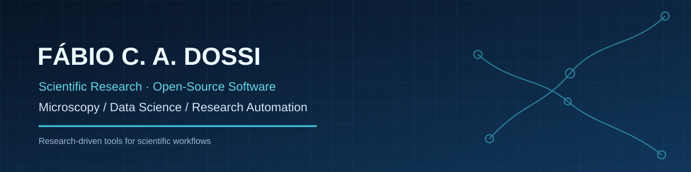

### Research scientist · Scientific software developer · Open-source contributor

**[English](#english)** · **[Português](#português)** · **[Projects](#featured-open-source-projects)** · **[Projetos](#projetos-em-destaque)**

---

## About me | English

I am **Fábio C. A. Dossi, PhD**, a research scientist with a background in biological sciences, entomology, experimental research, scientific microscopy, data analysis and interdisciplinary R&D. My software projects focus on **practical tools for scientific workflows**: improving access to literature, processing microscopy and spectroscopy data, and automating repetitive research tasks.

I work at the intersection of **scientific methodology and software development**, with particular interests in reproducibility, usable research tools and open science.

### Focus areas

- **Scientific imaging:** electron microscopy, image processing and microanalysis (SEM/EDS).
- **Scientific computing:** Python, quantitative analysis, data visualization and experimental workflows.
- **Research productivity:** Zotero extensions, PDF workflows, literature discovery and reference management.
- **Open science:** accessible tools, clear documentation and reproducible analysis.

### Featured open-source projects

| Project | What it does | Domain |
|:--|:--|:--|
| **[ZotFetch](https://github.com/fdossi/zotfetch)** | Zotero plugin for batch PDF retrieval with multi-source resolution. | Research automation |
| **[EDSMapPlotter](https://github.com/fdossi/EDSMapPlotter)** | Converts SEM-EDS/EDX CSV measurements into high-resolution elemental maps. | Scientific visualization |
| **[EDSLab](https://github.com/fdossi/EDSLab)** | Python application for EDS hyperspectral data processing, analysis and visualization. | Spectroscopy & data science |
| **[SciSeek](https://github.com/fdossi/SciSeek)** | Local-first desktop/CLI search for terms and patterns across scientific documents. | Document analysis |
| **[RefMerger](https://github.com/fdossi/refmerger)** | Merges, converts and deduplicates bibliographic references. | Reference management |
| **[Attach-Finder](https://github.com/fdossi/Attach-Finder)** | Zotero plugin that associates locally stored PDFs with library items using DOIs. | Research automation |

**Also exploring:** [ZotRead](https://github.com/fdossi/zotread) · [Fiji EZFig Fixer](https://github.com/fdossi/fiji-fixer) · [Python for Microscopists](https://github.com/fdossi/python_for_microscopists)

### Technical toolkit

---

## Sobre mim | Português

Sou **Fábio C. A. Dossi, PhD**, pesquisador científico com formação em Ciências Biológicas e experiência em entomologia, pesquisa experimental, microscopia científica, análise de dados e projetos multidisciplinares de P&D. Meus projetos de software procuram **simplificar fluxos de trabalho científicos**: facilitar o acesso à literatura, analisar imagens e dados espectroscópicos e automatizar tarefas repetitivas da pesquisa.

Atuo na interface entre **metodologia científica e desenvolvimento de software**, com interesse especial em reprodutibilidade, ferramentas de pesquisa acessíveis e ciência aberta.

### Áreas de atuação

- **Imageamento científico:** microscopia eletrônica, processamento de imagens e microanálise (MEV/EDS).
- **Computação científica:** Python, análise quantitativa, visualização de dados e experimentação.
- **Produtividade em pesquisa:** extensões para Zotero, tratamento de PDFs, busca científica e referências bibliográficas.
- **Ciência aberta:** ferramentas acessíveis, documentação e análises reproduzíveis.

### Projetos em destaque

| Projeto | Descrição | Área |
|:--|:--|:--|
| **[ZotFetch](https://github.com/fdossi/zotfetch)** | Plugin para o Zotero que automatiza o download de PDFs a partir de múltiplas fontes. | Automação científica |
| **[EDSMapPlotter](https://github.com/fdossi/EDSMapPlotter)** | Gera mapas elementares de alta resolução a partir de arquivos CSV de MEV-EDS/EDX. | Visualização científica |
| **[EDSLab](https://github.com/fdossi/EDSLab)** | Aplicação Python para processamento, análise e visualização de dados hiperespectrais EDS. | Espectroscopia e dados |
| **[SciSeek](https://github.com/fdossi/SciSeek)** | Busca local de termos, padrões e expressões em documentos científicos, por interface gráfica ou terminal. | Análise documental |
| **[RefMerger](https://github.com/fdossi/refmerger)** | Converte, combina e remove referências bibliográficas duplicadas. | Gestão bibliográfica |
| **[Attach-Finder](https://github.com/fdossi/Attach-Finder)** | Associa PDFs locais a itens do Zotero por identificação de DOI. | Automação científica |

**Outros projetos:** [ZotRead](https://github.com/fdossi/zotread) · [Fiji EZFig Fixer](https://github.com/fdossi/fiji-fixer) · [Python for Microscopists](https://github.com/fdossi/python_for_microscopists)

### Ferramentas e competências

Python · Git · Jupyter · NumPy · processamento e visualização de imagens · microscopia eletrônica · SEM/EDS · Zotero · desenvolvimento de ferramentas científicas · análise de dados experimentais

---

## GitHub activity | Atividade no GitHub

Statistics are supplied by an independent external service and may occasionally be unavailable.

---

### Connect | Contato

[GitHub](https://github.com/fdossi) · [LinkedIn](https://www.linkedin.com/in/fdossi/) · [Lattes](http://lattes.cnpq.br/7624981720350008) · [Email](mailto:fabio.dossi@gmail.com)

*Science-informed software · Open tools · Reproducible workflows*  
*Software orientado pela ciência · Ferramentas abertas · Fluxos reproduzíveis*

